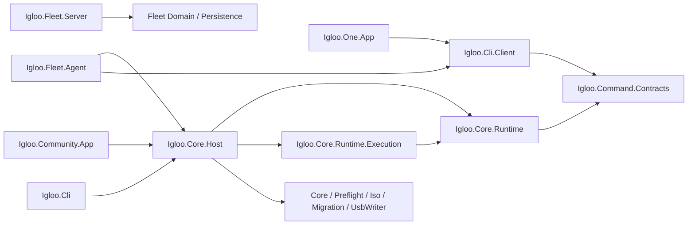

# Current Architecture

**CODE OBSERVATION, 10 October 2026.** This describes the dirty local working tree at committed HEAD `366c1ec`; it is not a statement about the remote branch or release. The physical arrows are direct project references confirmed in `.csproj` files. See [[02 - Architecture/Target Architecture]] for the different normative design and [[00 - Home/Architecture Drift Register]] for conflicts.

`Cli.Client` launches a CLI process for the One shell and Fleet development assessment. Community's private staging, installation preparation, cleanup, USB and maintenance services still use Host interfaces. Fleet Agent still has a Host dependency for transitional trusted dry-run and other local seams. Fleet Server references Domain and Persistence, not endpoint Host/CLI. The diagram shows project references; runtime calls and network work types have narrower meanings. [Product boundaries](../architecture/product-boundaries.md) and [implementation report](../spec/command-contract/implementation-report.md) provide context.

The CLI process uses Host's dispatcher. `CommandDispatcher` registers query and plan handlers; `IglooHost` adds operation, artifact and advisory target handlers and, in the normal host, ISO acquisition. The read-only Host factory omits ISO acquisition. [[03 - CLI and Command Contract/Current Capability Registry]] lists the actual public IDs and their limits. The CLI, Host, Runtime, Core services and providers form one logical Core authority; assembly names are composition details, not peer execution engines.

The currently available journal covers ISO acquisition and advisory records. No public migration operation spans Windows, installer and first boot. No current public install, boot, recovery mutation, `migration.prepare`, `migration.execute` or `migration.verify` handler is registered. A private Community Host path is not equivalent to a public machine capability. [[10 - Safety and Security/Safety and Security Overview]] explains the closed gates.

**Validation scope:** project references, dispatcher/Host registration, contract and selected tests were read. The vault update did not execute installation or physical hardware validation. A test that asserts today's Host edges cannot establish target A2.
