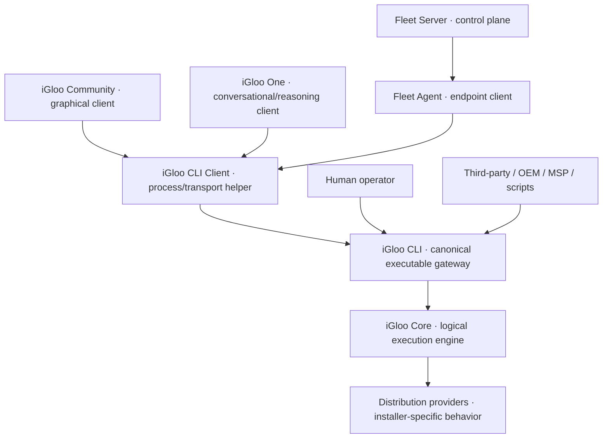

# Target Architecture

**NORMATIVE TARGET:** Supplied CLI-mediated whitepaper, 6 October 2026, §§2–4 and invariants A1–A10 on pages 7–8. Its cover is v1.0 and interior header v1.1; [[20 - Reference/Source and Whitepaper Version Index]] records the conflict. This is the intended logical topology, not the current `.csproj` graph.

The optional reusable CLI Client handles trusted location, process transport, protocol negotiation, cancellation and typed deserialization. It is not an engine and independent clients need not depend on it. Human use enters CLI directly. Fleet Server retains policy, scheduling, enrollment and sanitized evidence; only the endpoint Agent may translate authorized work into local CLI requests. The presence of an Agent is not approval for destructive remote work. One selects and presents typed capabilities; it cannot issue arbitrary privileged shell commands or reach Core directly.

Core is a logical authority across Host, Runtime, Preflight, ISO, Migration, USB, recovery and distro-provider assemblies. Providers contribute compatibility, rendering and first-boot deltas below Core. A distro maintainer can build a provider and a separate frontend, but that frontend uses the same CLI machine contract. The public Command Contract is a project interoperability specification, not an industry standard. See [[08 - Distribution Providers/Distribution Provider Overview]].

The A1–A10 obligations are expanded in [[02 - Architecture/Invariant Conformance Matrix]]. The target requires exact state/identity checks, safe secret custody, approval, recovery readiness, durable operation ownership, cross-reboot continuation and observed postconditions before destructive capabilities. See [[02 - Architecture/Architecture Convergence Plan]] for the safety order and [[02 - Architecture/Current Architecture]] for the current exceptions.
