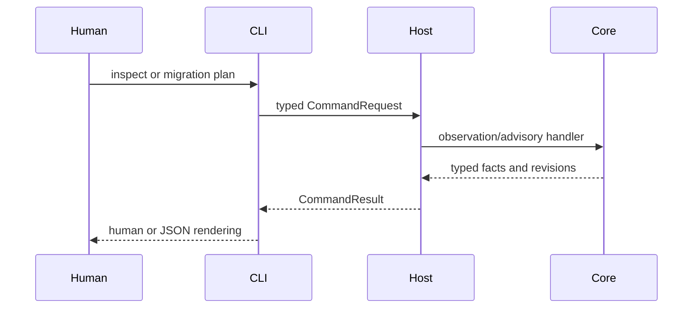
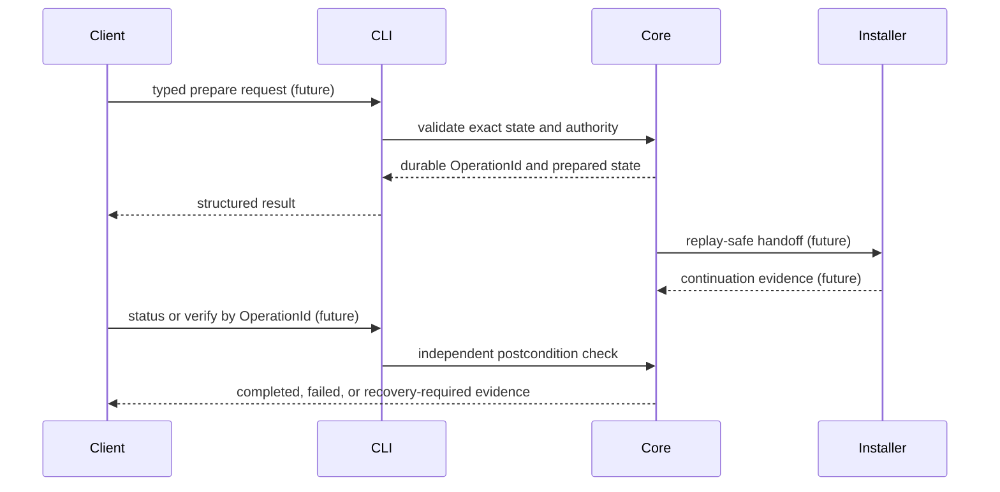

# Workflow Overview

**CURRENT:** A user can ask CLI for discovery, inspection, compatibility and advisory planning. `migration.plan` v2 may persist an advisory PlanId; `migration.target.bind` and `migration.target.allocate` return non-executable bindings. ISO/artifact acquisition is a low-risk cache operation with its own journal. Community's private migration/installation path still passes through Host, and Fleet's network flow remains assessment/dry run. [[03 - CLI and Command Contract/Current Capability Registry]] is the executable surface; [Community ownership](../architecture/community-installation-ownership.md) and [Fleet Phase 1](../fleet/phase-1.md) are narrower detailed sources.

**NORMATIVE TARGET:** Community, One and endpoint Fleet Agent use CLI process transport for the same capability semantics. A destructive migration would require exact intent/artifact/target/layout/approval/recovery checks before Core creates a durable OperationId, acquires ownership and crosses the reboot boundary. Installer and first boot continue that identity; a later status/verify query checks postconditions. This is whitepaper §§17.1–17.5, not an implemented workflow.

The second diagram represents a **blocked target**. No current public migration OperationId producer, installer continuation or `migration.verify` exists. Closing a CLI/GUI process after an accepted operation can create an unknown transport outcome; safe reconciliation depends on a durable producer. [[10 - Safety and Security/Safety and Security Overview]] and [[14 - Operations/Operations Overview]] cover failure handling.
