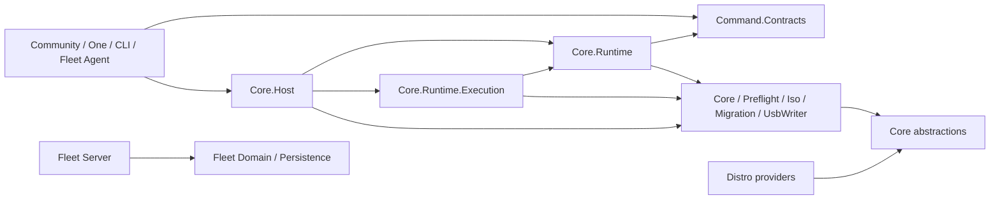

# Backend boundary cleanup audit — 2026-10-06

## Scope and evidence

This is an audit of the original working tree after `refactor/community-fleet-foundation`
was advanced from `5e4ebe846b488d8609612d37665aaefd4d203c88` to its direct child,
Core commit `366c1ec57c6e5bde6d452208d4ef6411ae99ebf1`. A safety ref,
`safety/community-fleet-before-core-boundary`, retains the former HEAD. The
operation used `git reset --mixed` only after the index tree matched the Core
commit tree. External binary diff and porcelain snapshots were saved; SHA-256
checks of all 178 pre-existing modified or untracked regular files matched after
the reset. The index is empty and this branch is locally one commit ahead of
origin. No branch was pushed. This new report is the only audit edit.

The graph below comes from active `*.csproj` `ProjectReference` elements in the
current working tree, not from a diagram or from historical copies in
`test-logs/history`. `Igloo.One.App` and its solution entry are concurrent,
uncommitted work; their current files are included for audit but were not
changed. The build and tests exercise the current working tree, including
unrelated Debian work, and are not proof of hardware installation.

## Physical project-reference graph

Arrows are direct `ProjectReference` edges. A missing arrow does not imply the
absence of transitive .NET type access.

| Project(s) | Direct project references |
| --- | --- |
| `Igloo.Command.Contracts`, `Igloo.Core`, `Igloo.Fleet.Contracts` | none |
| `Igloo.Preflight`, `Igloo.Iso`, `Igloo.Migration`, `Igloo.UsbWriter` | `Igloo.Core` each |
| Fedora KDE, Debian, Linux Mint Cinnamon, Ubuntu providers | `Igloo.Core` each |
| `Igloo.Core.Runtime` | Command.Contracts, Core, Preflight |
| `Igloo.Core.Runtime.Execution` | Command.Contracts, Core.Runtime, Iso, Migration |
| `Igloo.Core.Host` | Command.Contracts, Core.Runtime, Core.Runtime.Execution, Core, Preflight, Iso, Migration, UsbWriter |
| `Igloo.Cli`, `Igloo.Community.App`, `Igloo.One.App` | Command.Contracts, Core.Host each |
| `Igloo.Fleet.Agent` | Fleet.Domain, Fleet.Contracts, Command.Contracts, Core.Host |
| `Igloo.Fleet.Domain` | Fleet.Contracts |
| `Igloo.Fleet.Persistence` | Fleet.Domain |
| `Igloo.Fleet.Server` | Fleet.Domain, Fleet.Persistence |
| `Igloo.Fleet.Web` | Fleet.Contracts |

Test edges: Core.Tests → Core; Preflight.Tests → Preflight; Iso.Tests → Iso;
Migration.Tests → Migration, Fedora KDE and Debian providers; UsbWriter.Tests →
UsbWriter; Community.App.Tests → Community.App; Fleet.Tests → Fleet.Agent,
Fleet.Server and Fleet.Web; Command.Tests → Command.Contracts, Core.Runtime,
Core.Runtime.Execution, Core.Host and CLI; CanonicalImportQualification →
Debian provider. The source is the respective project file in `src/`, `distros/`,
`tests/`, or `Igloo.One.App/`; no active product project references an endpoint
execution assembly directly.

## Logical architecture

Community, One, CLI and Fleet Agent are local consumers of neutral Command
Contracts and the Core.Host composition boundary. Host composes Runtime,
Runtime.Execution and the existing Core/Preflight/Iso/Migration/UsbWriter
assemblies. Providers implement Core's `IDistroPlugin` contract. Fleet Server
remains a separate orchestration and policy service. Physical assemblies are
not the logical Core boundary: the command contract is public semantics, Host
is first-party local composition, and CLI is a text/JSON client rather than an
execution engine. The current implementation has both public command handlers
and private Host workflows; a Host call does not by itself imply command
dispatch, operation journaling, or a public capability.

## A. Preflight ownership: one implementation, several views

There are **not two Windows Preflight implementations**. Core's
`Abstractions/IPreflightChecker.cs` declares `IPreflightChecker` and the neutral
`PreflightReport`, `PreflightFinding`, `BitLockerState`; `DiskInfo` is in
`Abstractions/DiskInfo.cs`. `Igloo.Preflight/WindowsPreflightChecker.cs` is the
Windows implementation and is registered once in `Core.Host/IglooHost.cs`.
Runtime's `SystemInspectHandler`, `MigrationInspectHandler` and
`MigrationPlanHandler` call that checker and project selected facts into
Command.Contracts DTOs (`SystemInspection`, `InspectionFinding`,
`MigrationInspection`, `MigrationPlanResult`). Host's `PreflightWorkflow` adapts
the same checker for Community and also offers explicit removal/space cleanup;
its `InspectAndCleanupAsync` can mutate, unlike the `system.inspect` query.
These layers have distinct jobs. `IEndpointInspection` is a read-only Host view
over the domain report, used by Fleet; it is not another preflight engine.

## B. Operation paths and duplication

| Capability | Consumers and current entry | Implementation owner | Classification and reason |
| --- | --- | --- | --- |
| System inspection | CLI/One → `system.inspect`; Fleet → `IEndpointInspection`; Community → `IPreflightWorkflow` | One `WindowsPreflightChecker` | **CANONICAL** observation source; different DTO/adapters. Community's cleanup method is separately mutating. |
| Distro catalogue | CLI/One → `distro.list`/`distro.inspect`; Community → `IProviderCatalog` | Core `DistroLoader`; Host loads `DistroRegistry` too | **CANONICAL** catalogue source; manifest loader and plugin registry have distinct roles. |
| Compatibility | CLI/One → `distro.compatibility`; Community/Fleet → `IProviderCompatibility` | Runtime `DistroCompatibilityEvaluator` → provider `CheckCompatibility` | **DUPLICATE policy edge:** Community additionally rejects a distro without `secure-boot-supported` tag when Secure Boot is on (`DistroSelectionViewModel.cs`), whereas the command handler invokes only provider findings. Preserve current gate until parity is established. |
| Advisory migration plan / disk choice | CLI/One → `migration.inspect`/`migration.plan`; Fleet → `ReadOnlyPlanner`; Community → `DiskSelectionViewModel` | Runtime plan handler; Fleet and Community local heuristics | **DUPLICATE** observed-capacity/selection heuristics, with different policy/trust meanings. None authorizes execution; do not merge Fleet transport plans with command DTOs. |
| ISO acquisition | CLI → `iso.acquire`; Community → `IIsoWorkflow` | Both use `IsoAcquisitionCoordinator` → `IsoAcquisitionService` | **DUPLICATE entry/lifecycle path:** only command handler acquires `iso:<id>` ResourceLock and writes the operation journal. Community's private Host route calls the same verified ISO service without those command-level controls. This is a concurrency/evidence gap, not duplicate cryptographic verification. |
| Migration staging | Community → `IMigrationStagingWorkflow` | Runtime.Execution coordinator → Migration service, Core manifest generator, provider artifact writer | **LEGACY BUT STILL REQUIRED** private path. Credentials and `MigrationManifest` stay local; no public staging command exists. |
| USB preparation / resize | Community → `IUsbPreparation` | Host lease → Preflight resize + UsbWriter | **LEGACY BUT STILL REQUIRED** private path; no public USB command. |
| Installation preparation / boot registration | Community → `IInstallationPreparation` | Host lease → Preflight `DirectInstallService` and guarded recovery/boot code | **LEGACY BUT STILL REQUIRED** private path; no public install/boot command or command journal. Existing safety gates must remain. |
| Linux removal / reclaim | Community → `IPreflightWorkflow.RemoveLinuxAsync` and `InspectAndCleanupAsync` | Host lease → Preflight `LinuxRemovalService` | **LEGACY BUT STILL REQUIRED** private mutation, distinct from read-only `system.inspect`. |
| Recovery inspection | CLI/One → `recovery.inspect`; Community install path → Preflight snapshot capture | Runtime returns `ObservationUnavailable`; Preflight owns exact capture | **NOT YET MIGRATED**: the public query deliberately does not claim recovery readiness. |
| Recovery mutation | Community boot preparation → guarded Preflight recovery boundary; Fleet generic `RecoveryCoordinator<T>` only has test references | Preflight Community recovery executor; Fleet abstract adapter | **NOT YET MIGRATED** to commands. Fleet's generic `ApplyAsync` path is not registered as production remote work. Do not delete it or enable it without a separate safety review. |
| Operation status | CLI/One → `operation.status`; CLI → `migration.status` | Runtime.Execution `FileOperationJournal` | **CANONICAL** for current ISO journal; `migration.status` has no public migration-mutation producer yet. |

`ResourceLock` covers private Host disk, partition, boot, staging and recovery
calls and the command ISO route. It is process-shared via file leases, but the
Community ISO route does not request the ISO lease. The journal currently
records ISO acquisition only. The observed-state fingerprint in Runtime is an
advisory fact revision, not exact physical target identity or execution
approval. These limits are evidenced by `IglooHost.cs`, `IsoAcquireHandler.cs`,
`OperationJournal.cs`, and `MigrationReadOnlyHandlers.cs`.

## C–E. References, models and composition

There are **zero direct product → Core/Preflight/Iso/Migration/UsbWriter project
edges** in the current `*.csproj` graph. Remaining *source-level* Core type
coupling is real and transitive:

| Consumer | Exact type families still used | Why retained; removal status |
| --- | --- | --- |
| Community | `PreflightReport`, `DiskInfo`, `DiskInstallMode`, `DistroManifest`, `UserSetup`, file/ISO/USB progress and result types, `DirectInstallProgress`, `ThrottledProgress` | Existing WPF state and private Host workflow signatures; cannot remove wholesale without new Host-facing DTOs and parity tests. No direct execution assembly import was found. |
| Fleet Agent | `PreflightReport`, `DiskInfo`, `BitLockerState`, `FindingSeverity` for sanitized assessment/dry-run; `Observation<WindowsStorageSnapshot>` and BitLocker observations in target/recovery gates; `IRecoverableMutationAdapter<T>` in generic recovery coordinator | Fleet transport deliberately differs from local observations. Moving exact-proof recovery types needs a reviewed seam; the generic mutation coordinator has no production host registration. |
| CLI and One | No Core source imports or direct engine references found | Current contract/Host references are sufficient. |

`SystemInspection`/`PreflightReport` are **ADAPTER DTO / JUSTIFIED**: the command
view omits private disk/user detail. Fleet `AssessmentResult`,
`DeviceInventorySummary`, `DryRunFacts`, `PlanningDecision`, `FleetError`, and
`PreparedMigrationPlan` use the **SAME SOURCE DATA / DIFFERENT TRUST BOUNDARY**
and remain separate from Command DTOs. Core `MigrationManifest` and
`FileMigrationPlan` are local handoff state, not the command advisory
`MigrationPlanResult`; manifest includes credential-bearing browser fields and
paths, so sharing it publicly would breach the boundary. `LocalOperationRecord`
and Fleet's planning/execution journals track different authorities and are
**ADAPTER DTO / JUSTIFIED**. `DistroManifest`, provider `DistroMetadata`, and
`DistroSummary` represent catalogue, provider, and public view respectively.
The **ACTUAL DUPLICATION** found is the capacity/compatibility decision logic
described above, not these separate transport types.

Host is the single observed endpoint composition registration: `IglooHost.AddLocalBackend`
registers the checker, loaders, ISO, migration, install and USB services and
dispatcher. Community calls it once; CLI calls `CreateAsync`; One and Fleet call
`CreateReadOnlyAsync`. Fleet also registers its own identity/transport services,
which is not backend duplication. `CreateReadOnlyAsync` withholds the ISO command
and only exposes read-only `ILocalBackend` views, but its underlying DI setup
still registers mutating services. There is no demonstrated product bypass
through that interface; a later DI tightening could avoid constructing unused
services. Host's `IBackendCatalog`/`IProviderCatalog` and
`IEndpointInspection`/`IPreflightWorkflow` pairs separate load/list and
read-only/mutating roles; name similarity alone is not a reason to merge them.

## F–I. Historical code, One, providers, and Core cohesion

No source file is proven dead by this audit. `migration.status` currently has
no producer, and `recovery.inspect` is an explicit unavailable result; both are
forward seams, not silently removable code. Reflection-based `IDistroPlugin`
loading in Core, XAML-generated One/Community code, and serialized contract
records make grep-only deletion unsafe. `DistroRecommender` is a Community
presentation helper with source/test references. `RecoveryCoordinator<T>` and
Fleet's precommit gate are exact-proof research/safety code, not evidence that
remote destructive execution is enabled.

The untracked One project currently references only Command.Contracts and
Core.Host. `OneBackendClient` calls `CreateReadOnlyAsync` and dispatches
inspection, compatibility, advisory planning and status. No direct
Preflight/Iso/Migration/UsbWriter/Runtime.Execution reference or arbitrary shell
execution was found. One UI/product work remains uncommitted and was untouched.

Each active provider project references only Core. Core's `IDistroPlugin`,
`InstallerBootSpec` and compatibility contract are provider abstractions; no
provider → Community/One/Fleet/CLI edge was found. Generic runtime handlers
select provider IDs and invoke provider compatibility without embedding distro
installer semantics. Core itself contains neutral observation/domain contracts,
provider discovery, local manifest/handoff models, recovery and preparation
models, plus helper implementations such as `ManifestGeneratorService` and
`ThrottledProgress`. The manifest generator is used by Runtime.Execution; the
progress helper is still used by Community. Neither is proven historical dead
code. Core is broader than pure DTOs but remains UI/Fleet/AI independent in its
project graph; no code move is justified solely by file location.

## J. Documentation drift

`docs/reference/repository-structure.md` still calls CLI an untracked
placeholder with no commands and says there are seven xUnit projects. The
current solution has a working CLI and eight xUnit projects. Its tree omits
Command.Contracts, both Runtime projects, Core.Host and One. This is a concrete
current-state contradiction. `docs/architecture.md` and
`docs/architecture/product-boundaries.md` include older Community → service
diagrams, but they explicitly label those diagrams as historical/functional;
they should remain clearly labelled or be moved to history, not silently
treated as current project references. The command implementation report also
contains a labelled Phase 1 historical graph after its Phase 2 graph. Fleet's
current architecture introduction accurately places local inspection behind
Host; its historical sequence remains labelled.

## Recommended cleanup order and proposed graph

**SAFE NOW:** update the repository-structure page's CLI status, project list
and xUnit count using the `*.csproj`/solution evidence above. Optionally add a
focused architecture test asserting Community ISO uses the same lease/journal
entry as the command route before altering behavior. No source deletion or
model merge is justified yet.

**REQUIRES MIGRATION:** (1) make Community and CLI ISO acquisition share the
same operation lifecycle and cross-process lease while preserving graphical
progress and verified service semantics; (2) centralize provider compatibility
including the secure-boot catalogue gate, then test Community/CLI/Fleet parity;
(3) extract one pure capacity-observation helper with distinct Community and
Fleet policies and privacy mappings; (4) replace source-level Core types in
product signatures only where a stable Host-facing model is useful; (5) add
durable identity, exact target binding, stale-state validation, approvals and
recovery proof before exposing any destructive command. Each needs fixture
tests against the current path.

**DO NOT TOUCH YET:** Core's `IPreflightChecker`/report, Windows checker,
`MigrationManifest`, provider interface, direct-install/recovery safety code,
Fleet transport DTOs and precommit gates, or One's concurrent UI work. There
is no evidence supporting deletion/merge of these. No remote destructive
Fleet work type should be added.

The proposed physical graph keeps the present assembly boundaries and product
edges. The meaningful next simplification is semantic: all product ISO calls
should traverse one operation policy, and future safe mutations should cross
reviewed Host/command adapters into the same engine implementations. Host may
continue to reference separate engine assemblies; Fleet Server must remain
Domain/Persistence-only; providers must remain Core-only.

This is a logical simplification target, not a claim that every private Host
workflow is already a public command. The full direct-reference table above
remains the authoritative description of today's physical edges.

## Validation

- `dotnet restore Igloo.sln --nologo`: passed.
- `dotnet build Igloo.sln --no-restore --nologo -v:q`: passed, 0 warnings, 0 errors.
- `dotnet test Igloo.sln --no-build --nologo -v:q`: passed, 1,469 tests, 0 failures (Core 398; Preflight 343; Iso 19; Migration 461; UsbWriter 23; Community 58; Fleet 153; Command 14).
- Targeted `Igloo.Command.Tests`: 14 passed. Fleet `ArchitectureTests` filter: 1 passed.
- No live ISO acquisition, disk mutation, migration, install or recovery operation was run.
