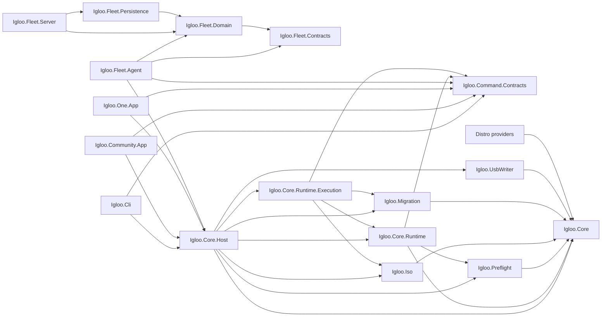
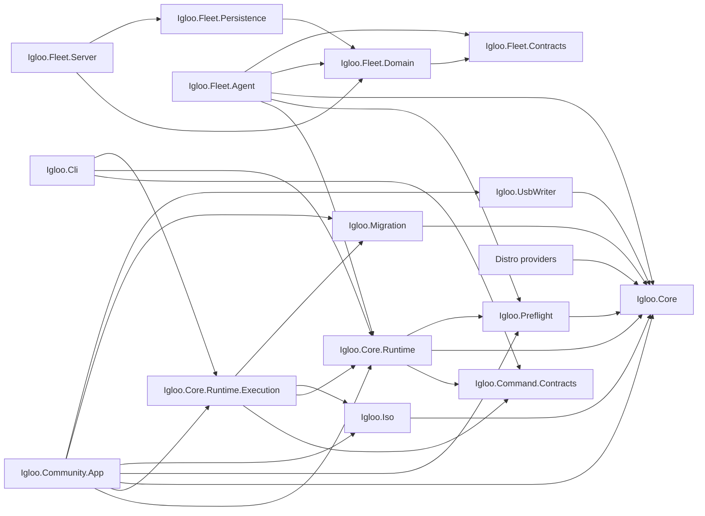

# Command boundary implementation report (2026-10-07)

**CLI executable-boundary transition: partial. Public destructive command state: not ready.** The [V1 contract](README.md) has a local Host boundary and advisory planning, but no endpoint installation, migration execution or recovery mutation command. Remote destructive Fleet execution remains absent. No real hardware mutation or live ISO download was used for validation. The Phase 1 and Phase 2 records below are historical baseline evidence; their then-current graphs and blocker statements must not be read as the current CLI-transition graph.

## Reviewed installer-layout substrate (2026-10-07)

Entry state was the dirty `refactor/community-fleet-foundation` worktree. Restore and build passed with zero warnings/errors; **1,507/1,507** tests passed. An external SHA-256 inventory recorded 179 modified/untracked regular files before edits. The existing advisory PlanId, TargetId, AllocationId V1 and ArtifactId semantics did not change.

**Decision graph before this increment:** Community passes a disk ordinal, requested Linux bytes, ISO path and staging path to Host and private `DirectInstallService`. Its first action is the closed `DedicatedEspPreparationSupport` gate. Behind that gate, legacy code measures mounted media, optionally reuses/deletes OEMDRV by label, chooses the shrink source by greatest supported-size delta, creates aligned partitions in available space, then observes their identities. The Fedora production template selects a disk by byte size with a largest-disk fallback and dynamically uses autopart. The guarded `PreparationPlanV1`/`PreparedLayoutV1`/`InstallerEspBinding` lab route was separate. The existing `FedoraOwnedStorageRecipe` already showed explicit owned-partition syntax, but was not the production renderer. No final layout passed from Windows through the installer.

**Internal model now:** `PreparationPlanV1.ReviewedIntent` binds private PlanId, TargetId, AllocationId references, artifact SHA-256, provider revision SHA-256, measured ISO/kernel/initrd/stage-2 byte counts, the canonical NTFS source, complete pre-partition inventory, exact shrink amount/result, and the freed extent. `PreparationSpacePlanV1` continues to prescribe contiguous aligned Linux ESP, payload, optional ISO and root geometry; `PreparedLayoutV1` continues to hold observed partitions, boot files and ownership. `VerifyReviewedIntent` checks the structural relationship between the source, pre-layout, shrink and prescribed extent. These digests are **declared binding facts**, not proof that the current artifact/provider was rehashed. Only a future runtime adapter can reopen and revalidate them against current content. This internal model issues no LayoutId, approval or mutation authority.

`DirectInstallService.ReviewPreparedIntent` applies the existing `PlanStorageSizes` arithmetic to those measured media facts and checks that payload/ISO/root reservations and the shrink cover the intended layout. The separate `PrepareReviewedAsync` entry accepts the plan rather than a disk ordinal and refuses at the unchanged dedicated-ESP gate. It does not call the legacy source heuristic, create a partition, or stage files. **Windows executor parity is partial:** the native exact-source resize, exact-offset creation and independent readback have not been wired to a production writer. The legacy private entry remains unchanged behind its gate; the reviewed entry cannot execute.

**Intention and receipts remain distinct.** `VerifyShrink` requires the resize provider result and a fresh independent canonical readback to equal the reviewed source with only its intended size changed. `PreparedLayoutV1.ShrinkReceipt` carries that observation, and complete storage ownership refuses a reviewed layout with a missing or changed receipt. The existing partition creation and filesystem receipts still require provider results and independent readback at the prescribed geometry. Partition GUIDs need not be guessed before creation; an unexpected offset, size, type or identity is refused. The reviewed Windows writer still needs implementation, so these are fixture-verified contracts, not production mutation evidence.

**Provider slice:** `IReviewedInstallerStorageProvider` is an opt-in interface below Core abstractions. Fedora implements it using the existing `FedoraOwnedStorageRecipe` and the same `InstallationOwnershipV1`/`PreparedLayoutV1`; it requires a reviewed plan, complete receipts, fresh installer inventory and matching generation. Its separate reviewed config renderer removes the legacy disk-search/autopart block and the Wi-Fi `%pre` script, and refuses every saved Wi-Fi network with `SecureNetworkCredentialHandoffUnavailable`. It renders explicit `ignoredisk --only-use`, `clearpart --none`, owned ESP and root `--onpart` directives. Fixture tests cover changed generation/target, missing shrink receipt and absence of largest-disk fallback, dynamic autopart and `nmcli ... password` from the **new renderer**. Fedora's ordinary `RenderInstallerConfigAsync` remains the transitional private template, including its plaintext Wi-Fi behavior. No staging coordinator calls the new renderer yet; its manifest must be independently checked before it is written to seed media. Debian, Mint, Ubuntu and other providers have not opted in, so their execution parity remains unavailable. The Fedora recipe's installer syntax and full boot/first-boot behavior still need disposable installer verification before production use.

**Recovery footprint:** `PreparedLayoutRecoveryFootprint.Derive` lists the reviewed NTFS resize, each exact partition creation and filesystem operation, Linux ESP files, BCD/boot registration, EFI variables/BootNext, RTC and staging handoff. It names missing restoration proofs instead of asserting readiness. The derivation is not a recovery snapshot or RecoveryId. Existing `recovery.inspect` remains `ObservationUnavailable`, and the dedicated boot/recovery gate remains closed. No production operation journal, durable ownership, approval, protected cross-OS Wi-Fi custody or OperationId continuation was introduced. Existing lab continuation fixtures do not constitute a Windows-to-installer-to-first-boot production handoff.

**Current state:** internal reviewed plan and shrink-receipt semantics are fixture tested; Fedora's opt-in exact storage/config renderer is fixture tested; native Windows exact mutation, installer end-to-end validation, exact recovery restoration, safe secret custody and continuation remain blocked. Therefore public LayoutId, RecoveryId, SecretHandle, `migration.prepare`, `migration.execute` and `migration.verify` remain unavailable. Community keeps its private Host workflow; One remains read-only/planning; Fleet trusted assessment/planning stays CLI based and Fleet Server cannot execute endpoint work.

Final validation: `dotnet restore Igloo.sln --nologo` passed; `dotnet build Igloo.sln --no-restore --nologo -v:q` passed with zero warnings/errors; `dotnet test Igloo.sln --no-build --nologo -v:q` passed **1,525/1,525** (Core 411, Preflight 349, Migration 464, Command 44, Fleet 157, Community 58, Iso 19, UsbWriter 23). The continuation subsets passed 23 Core and 30 Migration fixture tests. Fleet Phase 0 and Phase 1 scripts passed, and Phase 1 again reported no execution capability. The shareable docs validator returned no issues and the pre-existing orphaned backend audit note; `git diff --check` passed. No destructive storage, boot, recovery or reboot operation was run.

## Finalized-layout and custody investigation (2026-10-07)

This increment started from the dirty `refactor/community-fleet-foundation` worktree: restore and build passed with zero warnings/errors, and **1,501/1,501** tests passed. An external SHA-256 inventory recorded all 175 pre-existing modified/untracked regular files. The earlier PlanId, TargetId, AllocationId, ArtifactId and CLI work remains the baseline; this section supersedes earlier assumptions where the inspected implementation provides stronger evidence.

### Actual direct-install decision path

| Boundary | Current decision and mutation | Consequence for finalized layout |
| --- | --- | --- |
| Community and Host | `DirectInstallViewModel` passes a preflight disk **ordinal**, Linux byte request, local ISO path and staging directory to private `IInstallationPreparation`. Host uses ordered process leases; it does not receive public TargetId/AllocationId. | The private path cannot be claimed to consume a canonical public layout. |
| First line of `DirectInstallService.Prepare` | `DedicatedEspPreparationSupport.RequireSupported()` returns `DedicatedEspInstallerBindingNotImplemented` before ISO mounting, staging, resize or partition creation. | Current production preparation is blocked; bypassing the gate to manufacture a LayoutId is forbidden. |
| Legacy Windows source choice | If the gate were lifted, `PartitionResizeService.FindNtfsPartition` selects the lettered partition with the largest positive `SizeMax - SizeMin` on the ordinal disk, then aligns the requested new size to 1 MiB and may clamp above `SizeMin`. | It does not consume AllocationId V1's exact source partition or resulting geometry. |
| Media and provider sizing | `InstallerBootSpec` controls full-ISO copy, extra ISO files and pre-created root. `DirectInstallService` mounts media and measures kernel, initrd and extra payloads. ISO files at least 4 GiB get a separate NTFS partition; the FAT32 seed adds 512 MiB and the separate ISO partition adds 256 MiB. | Sizing depends on verified media **contents** and provider revision, not just ArtifactId text. The arithmetic is now in one private `PlanStorageSizes` helper used by the legacy service and tested with fixtures; it grants no layout authority. |
| Existing installer volumes | An OEMDRV volume can be reused by label and total size; an insufficient one is deleted. A separate ISO volume may be reused by label. | Label/letter discovery is not an ownership receipt and cannot justify a finalized layout. |
| Windows partition creation | `diskpart` creates/formats an aligned FAT32 OEMDRV and sometimes an NTFS ISO partition; `EnsureRootPartition` may create an unformatted Linux root using the largest remaining free region. Partition GUIDs are observed **after** creation. | Current commands do not pin exact free-extent offsets or creation identities before mutation. |
| Boot handoff | Boot files and fallback EFI loader are written to OEMDRV. Later `RegisterBootEntryAsync` plans BCD, EFI Boot####/BootOrder/BootNext and RTC writes, but the recovery boundary still refuses its unresolved footprint. | The installer/ESP relationship and boot mutation proof are incomplete. |
| Linux installer | Fedora's current kickstart `%pre` selects by disk byte size and falls back to the largest non-removable disk, then uses `clearpart --none` plus `autopart` for dual boot (or `clearpart --all` in replace mode). Other providers have distinct recipes; Debian's current plugin rejects exact target-root runtime preparation. | Size match/fallback and dynamic autopart cannot be bound to TargetId/LayoutId. The guarded `PreparedLayoutV1`/`InstallerEspBinding` lab models are not wired to this production recipe. |
| First boot | Internal manifest and agent move staged data and configure the installed OS. No public migration OperationId follows this route. | Successful installer exit alone cannot prove final layout or migration completion. |

**LayoutId status: unavailable.** A future LayoutId must be a new opaque, versioned identity for a reviewed *complete* pre-layout, exact source and shrink, full partition plan, installer target decision, ESP relationship, artifact and provider revisions, and expected post-layout. It must be persisted without secrets, reopened after process restart, and invalidated by changed TargetId/AllocationId, media, provider, catalogue or geometry. Existing `PreparationPlanV1`, `PreparedLayoutV1` and `InstallerEspBinding` provide useful internal pieces; they do not make the current executor consume a finalized plan. AllocationId V1 retains its narrower Windows NTFS shrink meaning and cannot be renamed or promoted. No public layout capability or LayoutId was registered.

### Secret lifetime and cross-OS custody

| Sensitive value | Producer; first and last consumer | Current representation and crossing | Protection, deletion and decision |
| --- | --- | --- | --- |
| Linux account password | Community `MigrationSetupViewModel`; Windows staging derives the crypt hash and browser-envelope key. Later graphical login asks the user for the password to decrypt browser credentials. | Plaintext is a managed Windows string during staging; SHA-512 crypt hash goes into the internal manifest and Fedora kickstart. Plaintext need not cross reboot for account creation. | No cross-process handle, defined TTL or assured memory clearing. Hash is sensitive handoff material; never put plaintext in argv or public records. |
| Browser passwords/cookies | Windows Chromium extractor; first-boot agent retains the envelope for the installed user's later graphical-login decryptor. | AES-256-GCM envelope, key derived from the user password with PBKDF2-HMAC-SHA256 (600,000 iterations); blob travels on the FAT32 seed/manifest and then into the installed home. | Key is not stored with ciphertext, but a copied envelope permits offline password guessing and replay; there is no expiry or machine binding. First-boot manifest redaction is best effort. This mechanism cannot transparently give the installer a Wi-Fi key. |
| Wi-Fi PSKs | Windows Wi-Fi scanner; Fedora installer `%pre` may use them for network access and Linux first boot writes NetworkManager keyfiles. | **Plaintext appears in both internal `migration-manifest.json` and Fedora rendered `ks.cfg`**, then on the FAT32 seed. The Fedora `%pre` script passes the key to `nmcli` as a process argument. Fedora and Debian-family first-boot agents consume manifest PSKs. | No encryption or meaningful access boundary on the seed; first-boot redaction is nonfatal and cannot erase prior copies. Public migration.prepare must refuse this custody pattern. Removing PSKs from today's private path would change unattended connectivity and first-boot Wi-Fi behavior, so this increment does not silently do so. |
| Other private data | Windows file/browser/profile staging; installer and first-boot migration. | Private files, paths, profile databases and wallpaper/avatar metadata cross staging and reboot. | Excluded from public IDs, plan/layout records, operation journal and Fleet transport. Their full retention/deletion contract still needs review. |
| Tokens/private keys | No dedicated token or private-key property was found in the inspected `MigrationManifest` model. | Browser profiles and selected user files may themselves contain such material. | No claim of exhaustive content sanitization is made. |

The browser envelope's password-derived key is available only when the user enters the password again; a Windows-only DPAPI handle cannot be consumed by Linux. Storing ciphertext and an automatically usable key together on FAT32 would not provide meaningful custody. A defensible future design must explicitly choose user re-entry at installer/first boot, or a separately proven cross-OS protected-key mechanism, then define authorized readers, machine binding, replay resistance, expiry, crash cleanup and deletion. Local administrators can access the Windows staging process and files; physical readers of the seed can copy its contents. No SecretHandle/SecretBundleId is issued and no public path accepts plaintext Wi-Fi credentials.

### Recovery mutation footprint and readiness

| Legacy mutation class | Observation available | Restoration status |
| --- | --- | --- |
| NTFS resize and GPT changes | Canonical storage identity, partition geometry and supported size can be read. | Exact reversal of a shrink and restoration of filesystem/data are unproven. |
| Deletion/reuse/creation/format of OEMDRV, ISO and optional root partitions | Pre/post partition observations and guarded preparation receipts exist in separate models. | The legacy label-based branch is not bound to those receipts; deletion and ambiguous leftovers are not recoverable by the current public path. |
| Staging, installer config, payload and fallback EFI files on OEMDRV | Files can be inventoried in guarded preparation fixtures. | Content cleanup and exact restore are not proven; the legacy handoff contains private data. |
| BCD objects, EFI Boot####/BootOrder/BootNext and RTC | `WindowsRecoverySnapshotCapture` can observe many required elements and independently read back; `CommunityBootRegistrationPlan` lists proposed slots. | The native BCD/firmware synchronization and deletion side effects remain unresolved; the current recovery boundary blocks writes. |
| Installer partitioning, filesystem creation and first-boot changes | Guarded Linux inventory/ownership and continuation lab fixtures exist. | Fedora's current dynamic target selection/autopart and real first-boot effects are not bound to the Windows intent or proven reversible. |

`RecoverySnapshotV1` and its artifact store can persist/reopen observations for supported scopes, but observation is not restoration. `RecoverySnapshotRules` explicitly rejects the complete direct-install footprint, and production `recovery.inspect` remains `ObservationUnavailable/ExactSnapshotNotCaptured`. No target/layout-bound RecoveryId or `Ready` claim is issued. Future readiness must distinguish incomplete observation, unproven restoration and limitations from proven recovery, and must remain tied to the actual mutation subset.

### Approval, ownership and continuation

An internal `MigrationExecutionIntentFingerprint` now deterministically hashes a **hypothetical complete** versioned tuple: PlanId, TargetId, AllocationId, LayoutId, ArtifactId, RecoveryId, plan/provider/target/allocation/layout/recovery revisions and destructive risk. It rejects empty identities or malformed revisions. Changing any bound fact changes the hash. Because LayoutId and RecoveryId do not exist, no real execution intent can be formed. The hash is neither approval nor authority; future approval evidence needs an authenticated issuer/principal, expiry, policy decision and exact hash binding. Community, direct CLI and future Fleet approvals must use the same intent semantics, with issuer/policy attribution kept separate.

For durable ownership, a future migration journal must atomically claim canonical target/layout resources under a short-lived ordered cross-process lease, then persist active OperationId ownership across process exit and reboot. New clients must distinguish no owner, active owner, completed owner and stale/recovery-required owner; an ambiguous stale claim must not be auto-reclaimed. The existing ISO journal and file leases have no migration OperationId producer or durable target ownership. No approval record or migration ownership journal was added.

The proposed Windows -> staged installer -> installer -> first-boot -> verification OperationId chain remains unimplemented. Existing `InstallationContinuationV1` and Debian lab tests exercise versioned identity/checkpoint lineage and reject mismatches/replay in fixtures, but are not a production CLI handoff. The current Fedora target-selection fallback also prevents safe cross-OS TargetId/LayoutId correlation. No live reboot or destructive fixture is claimed.

`migration.prepare`, `migration.execute` and `migration.verify` remain **unregistered**. Community retains its private Host path (currently guarded before direct-install mutation); One remains read-only/planning; Fleet trusted inspection/planning stays CLI-based, Fleet Server remains isolated, and remote destructive work is absent.

Validation for this increment: full solution restore passed; full build passed with zero warnings/errors; full test run passed **1,507/1,507** (Core 398, Preflight 347, Iso 19, Migration 461, UsbWriter 23, Community 58, Fleet 157, Command 44). Four new Preflight tests cover the production sizing arithmetic; two new Command tests cover deterministic complete-intent hashing and rejection of incomplete intent. Fleet Phase 0 read-only assessment and Phase 1 trusted non-executable planning/restart demonstrations passed. Existing continuation suites passed directly (Core 23, Migration 30). All new execution work is fixture-only; no destructive storage or reboot was attempted.

## Advisory AllocationId and safety-gate audit (2026-10-06)

Entry on `refactor/community-fleet-foundation` used the current dirty working tree, with a clean Git index. Restore/build passed with zero warnings/errors and all **1,495** entry tests passed. A separate external SHA-256 snapshot covers 173 pre-existing modified/untracked regular files. The earlier CLI, TargetId, Debian, recovery, One and vault changes were retained; no branch reset or unrelated cleanup was performed.

### Implemented allocation subset

`migration.target.allocate` V1 is a low-risk PLAN capability, available to human CLI and the same machine dispatcher. It takes PlanId, TargetId and `requestedShrinkBytes`; it reloads an unblocked advisory V2 plan, checks provider/machine revisions and the canonical TargetId, and observes the Windows boot partition's whole GPT layout and `GetSupportedSize` minimum/maximum twice. The storage reader correlates the selected partition by GPT GUID, type, offset, size and volume identity. Disk/partition ordinals only join rows within one observation and are not retained in the layout fingerprint. The proposed shrink follows the existing Windows resizer's 1 MiB downward alignment, requires current `SizeMax` to equal the observed partition size and rejects a resulting size below `SizeMin`. The result reports requested and actual shrink, resulting Windows partition size, the newly freed extent's start, a layout revision and `executable: false`.

The private `%LOCALAPPDATA%\Igloo\allocations` record contains random AllocationId, PlanId, TargetId, bound plan fingerprint, exact shrink/result values and a hash of canonical disk/partition geometry plus supported-size limits. It contains no raw storage identity, manifest or credential. Reopening through another process re-resolves TargetId and re-observes the layout twice. Partition replacement, new occupancy in previously unallocated space, geometry or shrink-limit change, target replacement, wrong IDs and corrupt records fail closed; disk renumbering alone is tolerated. The integrity digest is corruption detection, not local-account tamper resistance. Tests use fixtures only.

**Scope limit:** This V1 AllocationId means `WindowsBootNtfsShrinkIntentV1`. It binds one exact *proposed* NTFS shrink, not the entire installer storage mutation. The current DirectInstallService measures ISO contents during private preparation, may reuse/delete an OEMDRV leftover, and picks a shrink candidate through a legacy letter/shrinkability heuristic. `PreparationSpacePlanning` expects an independently verified contiguous extent *after* shrink and describes a different guarded preparation path. Neither currently consumes this AllocationId. Artifact-specific seed/ISO sizing, new partition creation and the executor's exact source-selection parity are unbound. The public result always carries `InstallerLayoutNotBound` and is non-executable. A future complete allocation version must bind those facts before `migration.prepare` may accept it.

### Recovery evidence and identity

`WindowsRecoverySnapshotCapture` can read canonical storage, BCD dependency graph, firmware entries, ESP/boot-manager identity, WinRE and optional RTC/registry state, and perform a second readback. `RecoverySnapshotRules` can classify incomplete, ambiguous and changed evidence. This is observation, not proven restoration. For Community direct install the mutation footprint is explicitly unresolved (`DirectInstallMutationFootprintNotIntegrated`); active WinRE/BCD/EFI proof can also be unavailable. Public `recovery.inspect` still returns `ObservationUnavailable/ExactSnapshotNotCaptured`. No RecoveryId is issued. For this proposed shrink, required readiness includes exact pre-mutation partition/boot relationship, complete affected BCD/EFI/WinRE scope, recoverability of the intended storage/boot changes and verified independent readback. Those requirements are not met; no partial snapshot is promoted to `RecoveryReady`. Future readiness should distinguish `RecoveryReady`, `RecoverableWithLimitations`, `ObservationIncomplete` and `RecoveryUnavailable`; none is currently a public promise for migration execution.

### Sensitive-input lifetime audit

| Input | Windows use | Crosses process/reboot? | Current internal handoff and public decision |
| --- | --- | --- | --- |
| Linux account password | Community holds a managed string; staging derives SHA-512 crypt and the browser-envelope key | Plaintext is needed during Windows staging, not by the first-boot agent; the password hash crosses reboot for account creation | Keep plaintext out of CLI argv/results/journal. No cross-process SecretHandle exists. Password hash is still sensitive handoff material, not a public DTO. |
| Browser logins/cookies | Windows DPAPI unlocks selected Chromium credentials; staging encrypts an AES-GCM envelope under a password-derived key | Encrypted envelope crosses reboot; first boot moves it to the user's home, then graphical login requests the password for decryption | Existing envelope and profile files remain private internal handoff state. No public prepare custody is claimed. |
| Wi-Fi PSK | Windows scanner collects saved network keys | **Plaintext PSK crosses reboot** in the internal MigrationManifest/seed and is consumed by Linux first boot before best-effort redaction | This is a specific unresolved cross-OS custody and seed-access threat. A Windows DPAPI handle cannot solve it; public prepare remains blocked. |
| User files, browser profiles, paths, wallpaper | Copied/staged by the private workflow | Data and private path metadata cross installer/first-boot stages | Never place contents or paths in PlanId, TargetId, AllocationId, public results, Fleet transport or operation journal. |

`CredentialProtector` has a stale comment suggesting the plaintext Linux password is in the manifest; the current `ManifestGeneratorService` writes a password hash, while the Fedora first-boot agent explicitly says it does not have plaintext. That discrepancy should be corrected in a separately reviewed security documentation change. No generic secret store or SecretHandle was registered here. The eventual custody contract must authenticate a local consumer, issue a short-lived one-use handle, protect transient Windows state, delete on consumption/expiry/crash cleanup, and explicitly solve the separate cross-OS Wi-Fi and account-handoff risks. The current manifest remains internal.

### Approval, ownership and continuation design

A future approval reference must be client-neutral and bind exact PlanId, TargetId, a **complete** AllocationId, ArtifactId, state/layout revisions, risk, approving principal/context and expiry. The issuer/verifier must be authoritative for local human or future audited Fleet approval; product-name flags cannot change migration semantics. No such approval capability exists, and none of the advisory IDs grants authority.

The existing `ResourceLock` uses ordered cross-process file leases. A future prepared migration would acquire canonical `target:<TargetId>`, `allocation:<AllocationId>`, `partition-table:<TargetId>`, boot, staging and recovery resources in stable order. An open handle ends with its process and cannot represent cross-reboot ownership. Durable ownership must be an active OperationId claim in a validated journal, checked while holding the short-lived process lease; stale claims require independent reconciliation, not automatic takeover. The current ISO journal has no migration OperationId producer, prepared state, replay fence or durable ownership record.

The **proposed, unimplemented** continuation is Windows journal `OperationId` -> internal installer handoff identity -> first-boot identity -> independently read completion evidence correlated to the same OperationId. Windows preparation would write the journal entry before writing a versioned private handoff descriptor alongside existing installer handoff state; the exact path and protection remain unresolved. The installer must verify that descriptor against the journal-bound plan/target/allocation, expected checkpoint hash and stage sequence before accepting it. Linux first boot must locate the retained private descriptor through the existing handoff mechanism, verify the same identity and sequence, and record completion evidence for later journal reconciliation by a new CLI process. A repeated stage/sequence or mismatched operation must fail closed; an absent or inaccessible journal cannot be treated as completion. `MigrationManifest` may carry only the minimum internal correlation after a real prepared operation exists. Existing Debian `InstallationContinuationV1` and related fixture tests exercise OperationId/checkpoint lineage and replay rejection in a lab path, but do not constitute a Windows-to-Linux production CLI handoff and were not changed. There is no safe public migration OperationId to fixture-test end-to-end yet.

`migration.prepare`, `migration.execute` and `migration.verify` remain **unregistered**. Prepare lacks complete installer layout, recovery readiness, cross-process/cross-OS secret custody and approval; execute additionally lacks durable ownership, replay protection and continuation; verify lacks trustworthy first-boot and storage/boot postcondition evidence. Community therefore retains Host for private destructive workflows. One remains a CLI read-only/planning consumer. Fleet trusted assessment/planning remains CLI-based, Fleet Server stays isolated, and remote destructive work is absent.

### Validation for this increment

`dotnet restore Igloo.sln --nologo` passed; `dotnet build Igloo.sln --no-restore --nologo -v:q` passed with zero warnings/errors; `dotnet test Igloo.sln --no-build --nologo -v:q` passed **1,501/1,501** tests (Command 42, Core 398, Preflight 343, Iso 19, Migration 461, UsbWriter 23, Community 58, Fleet 157). Six Command tests cover the allocation source, durable registry reopen, renumbering, stale/replaced geometry and supported-size refusal, corruption, public DTO isolation and CLI/dispatcher parity. Existing lab continuation suites also passed when run directly (Core 23; Migration 30); they do not verify production Windows-to-Linux handoff. The Phase 0 read-only Windows assessment and Phase 1 trusted enrollment/planning/restart demonstrations passed; the latter remained Prepared and non-executable. The shareable docs validator reported no issues, although an unrelated existing architecture audit note remains orphaned in the vault graph. `git diff --check` passed. No destructive hardware operation or actual reboot was attempted.

## Advisory canonical TargetId increment (2026-10-06)

This increment began on `refactor/community-fleet-foundation` at `366c1ec57c6e5bde6d452208d4ef6411ae99ebf1` with a clean index and unrelated dirty Debian, recovery, One and documentation work preserved. Entry restore and build passed with zero warnings/errors; all 1,490 entry tests passed. Earlier sections below record their own historical states and counts.

`migration.target.bind` V1 is now a PLAN capability. Its typed input is a saved V2 PlanId; its result is an opaque TargetId, bound plan fingerprint and `executable: false`. The handler reloads the plan, refuses blockers or uncertain capacity, checks provider revision and preflight revision, and observes the exact Windows boot volume twice. The identity comes from the existing Core recovery canonical storage binder: provider unique disk identity, GPT disk and partition GUIDs, volume GUID, disk/partition geometry and sector sizes. The preflight disk number is used solely to correlate two observations and is not retained as authority. The private `%LOCALAPPDATA%\Igloo\targets` record contains the PlanId, plan fingerprint and hash of the canonical identity, without raw storage identifiers or paths. Reopening rejects the wrong plan, changed binding or replaced target. A disk ordinal change alone does not change the TargetId binding. The record integrity digest detects accidental corruption, not malicious edits by the same local account. No hardware mutation was performed.

The capability is available through the CLI human command `migration target bind <plan-id>` and the same machine request dispatcher used by independent clients. New fixture tests cover strict Windows identity observations, durable reopen, wrong and replaced targets, disk renumbering, stale preflight, blocked plans, corruption and rejection of product identity in typed input. Its input uses the existing plan-selection schema and its result has a public JSON schema. No product-specific flag or caller branch was added.

**Safety stop:** A TargetId binds the Windows boot disk identity, not the installer's exact free-space allocation; it remains advisory and cannot authorize mutation. The current `recovery.inspect` still reports `ObservationUnavailable/ExactSnapshotNotCaptured`; the recovery mutation footprint is not integrated. No protected cross-process SecretHandle, migration prepare gate, durable migration OperationId producer, cross-reboot continuation or actual postcondition verifier exists. The existing ISO journal and cross-process leases do not prove that full lifecycle. Therefore `migration.prepare`, `migration.execute` and `migration.verify` remain unregistered, Community retains its private Host operational path, One remains read-only/planning, and Fleet remote destructive execution stays disabled. Future migration preparation must revalidate the PlanId, provider, state, TargetId, artifact content, exact capacity, recovery proof and secret handles before creating an operation; execution must add bound approval, replay protection and ordered resource leases. The journal must never contain secrets or MigrationManifest content.

Final validation for this increment: `dotnet restore Igloo.sln --nologo` passed; `dotnet build Igloo.sln --no-restore --nologo -v:q` passed with zero warnings/errors; `dotnet test Igloo.sln --no-build --nologo -v:q` passed all 1,495 tests (Core 398, Preflight 343, Iso 19, Migration 461, UsbWriter 23, Community 58, Fleet 157, Command 36). Both `scripts/test-fleet-phase0.ps1 -Configuration Debug` and `scripts/test-fleet-phase1.ps1 -Configuration Debug` passed read-only/trusted Fleet demonstrations; Phase 1 confirmed no execution capability. The documentation validator exited zero with no issues and its pre-existing orphaned backend audit note; `git -c core.safecrlf=false diff --check` passed. The entry SHA-256 snapshot showed no missing files and no unexpected byte changes among pre-existing dirty regular files. No migration/install/recovery or live ISO acquisition was executed.

## Trusted Fleet CLI and observation binding (2026-10-06)

The trusted Fleet Agent entry now invokes `Igloo.Cli.Client` for read-only assessment and migration dry-run. It sends `system.inspect` V1, `migration.plan` V2 and `distro.compatibility` V1 through the CLI process and converts only reviewed typed fields into Fleet's separate sanitized evidence. The configured `IGLOO_FLEET_DISTROS` path is passed to that CLI process as `IGLOO_DISTROS_DIRECTORY`; it is never a command-line argument. The Host-backed planner/assessment adapters remain in Agent for fixture and transition tests, so the project-level Agent to Host edge has **not** yet been removed.

`system.inspect`, `system.inspect.detail` and `distro.compatibility` now return the machine observation revision in the standard result envelope. Plan V2 exposes both that raw `observedMachineFingerprint` and its provider-bound `observedStateFingerprint`. Fleet accepts a dry-run only when the inspection, plan and compatibility revisions agree and the plan is advisory, non-executable and bound to the requested distro and minimum bytes. A mismatch or malformed result becomes sanitized `LocalExecutionFailed` evidence, which Fleet policy cannot approve. The first Phase 1 rerun correctly stopped with Unknown eligibility because `system.inspect` initially lacked the revision; after adding it, the script passed. This check establishes evidence consistency, not installation permission or a durable physical target identity.

Final validation after this increment: restore passed; full solution build passed with 0 warnings and 0 errors; all **1,490 tests** passed (Core 398, Preflight 343, Iso 19, Migration 461, UsbWriter 23, Community 58, Fleet 157, Command 31). The Phase 0 script submitted a real read-only assessment; the Phase 1 script passed mTLS enrollment, real read-only assessment/dry-run, evidence-bound approval, non-executable Prepared plan and server-restart persistence. Neither script ran endpoint mutations. The documentation validator reported `issues: []` and the pre-existing orphaned backend audit note.

## Safe command convergence increment (2026-10-06)

The entry working tree already contained the executable CLI boundary and unrelated Debian, recovery, One and vault work. Its clean index, restore, build and 1,476 passing tests were recorded before edits. This increment leaves project references unchanged. CLI alone still composes Host; Community retains private Host workflows for capabilities without safe public parity; the trusted Fleet entry now calls CLI while test adapters retain Host.

`system.inspect.detail` V1 is a new query with explicit public DTOs. It reports the unchanged `system.inspect` summary, disk and partition geometry, observed capacity, and Linux/installer-leftover counts. Ordinals are display positions, **not** stable disk identities. Device IDs, disk models, labels, GPU strings, raw findings and remediation text are not serialized. Only reviewed finding codes cross the command boundary; other codes become `ProviderFinding` with severity retained. It has a separate capability ID to keep the existing `system.inspect` result schema compatible with strict clients. The CLI accepts `inspect detail --json`, and the same capability is available through `invoke --machine`.

`MigrationCapacityEvaluator` in neutral Core now provides one advisory classification for known available, measured insufficient, unknown, physical disk too small and ambiguous Windows boot disk. Runtime migration inspection/planning and Fleet's transitional dry-run adapter call it; their public/Fleet records remain distinct. The catalogue Secure Boot tag rule now lives in `DistroCompatibilityEvaluator` alongside provider findings. CLI and Host use that evaluator with the loaded catalogue; Community no longer applies a separate Secure Boot branch, and a missing or failing provider compatibility check disables selection. The compatibility and capacity fixture tests cover these paths. No actual installation target is bound by these read-only results.

`artifact.acquire` reuses the `iso.acquire` handler's verified acquisition, lease, progress and operation journal path. Real ISO acquisition now passes its computed SHA-256 to the internal result. A private file registry under `%LOCALAPPDATA%\Igloo\artifacts` maps the public, provider-scoped content ID to the cache path; the registry file carries schema version and an integrity digest. `artifact.status` reopens the record and rehashes the cached file. Fixture tests prove reopen, changed-content detection and structured rejection of corrupted metadata. The legacy `iso.acquire` result schema remains unchanged. Neither ID nor status grants installation authority; the registry has not been used across a real reboot or with a real ISO download in this increment.

`migration.plan` V2 now allocates a random PlanId and saves a schema-versioned advisory record in `%LOCALAPPDATA%\Igloo\plans`. Its revision binds the observed machine facts, selected provider binary, provider catalogue and distro ID; its result exposes typed capacity state, the raw machine observation revision and the provider revision fingerprint. `migration.plan.read` reloads it through a later CLI process. The dispatcher serves both V1 and V2 under the same capability ID; CLI human planning chooses V2, while explicit V1 requests retain their original result schema. Tests reopen the journal, compare CLI JSON planning/read semantics, prove the revision changes with observed state and reject corrupted records. The saved plan contains no credentials, manifest or filesystem paths, and `executable` is always false.

Intermediate validation before the final Fleet increment: `dotnet restore Igloo.sln --nologo` passed; `dotnet build Igloo.sln --no-restore --nologo -v:q` passed with 0 warnings and 0 errors; `dotnet test Igloo.sln --no-build --nologo -v:q` passed **1,485 tests** (Core 398, Preflight 343, Iso 19, Migration 461, UsbWriter 23, Community 58, Fleet 154, Command 29). `Igloo.Cli.exe inspect detail --json` returned a structured read-only result on this host. The docs validator exited 0 with no issues and the same pre-existing orphaned backend audit note; `git -c core.safecrlf=false diff --check` passed. SHA-256 comparison of all 151 pre-existing dirty regular files found no unexpected byte changes. No migration/install/recovery, disk, boot or live ISO acquisition command was executed.

The requested complete lifecycle is **not implemented**. Community still directly uses Host for preflight cleanup, catalogue presentation, private ISO path handoff, sensitive staging, USB and installation preparation; Fleet trusted dry-run now uses CLI; Host-backed test adapters remain in Agent. The current `system.inspect.detail` ordinals cannot authorize disk selection, the new artifact ID has no migration consumer, a durable advisory PlanId has no prepare/execute consumer, and the ISO journal cannot continue a Windows-to-installer-to-first-boot migration. Secret custody, exact target binding, recovery readiness and post-reboot verification must be established before registering `migration.prepare`, `migration.execute` or `migration.verify`. Closing Community during its current private workflow may still interrupt that workflow; no cross-reboot durability claim is made.

## CLI executable-boundary transition (2026-10-06)

Entry was branch `refactor/community-fleet-foundation` at `366c1ec57c6e5bde6d452208d4ef6411ae99ebf1` with a clean index and unrelated dirty/untracked Debian, recovery, One and documentation work. The full entry restore/build/test passed (1,469 tests across eight projects). The actual binaries are `Igloo.Cli.exe` for CLI and `iGloo.exe` for Community. No binary was renamed.

The new `Igloo.Cli.Client` project references only `Igloo.Command.Contracts`. It resolves a known CLI path, starts one process per request with `invoke --machine`, validates the CLI's uncorrelated protocol/product `hello` **before** passing a typed request on stdin, then validates the correlated JSON Lines `accepted`/`progress`/`result` stream and returns typed `CommandResult` data. Stderr is diagnostic only. Request input never appears in argv. Cancellation sends a typed control line and waits for a structured result; forced process termination is a transport failure with unknown operation outcome. The CLI's human and machine modes call the same dispatcher. Process metadata and installation location checks do not establish a cryptographic executable signature; packaging the CLI with each client remains an open deployment gate.

Current direct project edges for the executable boundary are:

| Product | Current direct project references | CLI status |
| --- | --- | --- |
| CLI | Command.Contracts, Core.Host | Sole executable using Host for V1 commands |
| One | Cli.Client, Command.Contracts | Read-only backend wrapper uses the CLI process; One UI remains unfinished |
| Community | Command.Contracts, Core.Host | Existing operational workflows remain on private Host interfaces |
| Fleet Agent | Cli.Client, Command.Contracts, Core.Host, Fleet.Contracts, Fleet.Domain | Development assessment uses CLI; trusted dry-run still uses Host |
| Fleet Server | Fleet.Domain, Fleet.Persistence | No CLI/Core endpoint reference |

`system.version`, capability discovery, `system.inspect`, distro queries, advisory migration queries, status, recovery inspection and `iso.acquire` are available through the CLI machine stream. No endpoint-destructive command was added. Fleet's assessment mapping has a fixture parity test between private `PreflightReport` and the public `SystemInspection` DTO; it still emits only sanitized Fleet evidence. Fleet dry-run needs disk capacity and provider implementation facts not present in the public DTOs, so its private Host route is retained rather than weakened. Community needs rich preflight findings, local ISO cache handoff, sensitive staging input and exact installation safety gates absent from V1. Removing those Host paths now would change behavior or expose private state. `MigrationManifest` remains private local handoff state. Operation IDs can be queried through a new CLI process where journal records exist; no cross-reboot installation continuation is claimed.

The command test project exercises a real `Igloo.Cli.exe` process, machine framing, typed client discovery/results/errors, cancellation framing and human/machine `system.version` parity. Fleet tests exercise sanitized assessment parity. Architecture tests pin Cli.Client's neutral reference, One's lack of Host and the development Fleet entry path. The remaining Community and Fleet Agent Host edges are explicit migration work, not a hidden fallback.

Entry and final commands: `dotnet restore Igloo.sln --nologo`, `dotnet build Igloo.sln --no-restore --nologo -v:q`, and `dotnet test Igloo.sln --no-build --nologo -v:q`. Entry passed with 0 build warnings/errors and 1,469 tests. Final passed with 0 build warnings/errors and 1,476 tests (Core 398, Preflight 343, Iso 19, Migration 461, UsbWriter 23, Community 58, Fleet 154, Command 20). `python scripts/validate_docs_vault.py --shareable --json` exited 0 with no issues; it reported the pre-existing unlinked `backend-cleanup-audit-2026-10-06.md`. `git diff --check` exited 0 with line-ending normalization warnings from existing dirty files. Five local `system.version --json` CLI launches took 183–207 ms (median 188 ms) on this development machine; no throughput conclusion is drawn.

## Phase 2 local backend consolidation

### Baseline and scope

The existing working tree was already dirty on `refactor/community-fleet-foundation`. At entry, `git status --short --branch` showed the in-progress command projects, concurrent untracked `Igloo.One.App`, extensive Debian and documentation work, and the Phase 1 tracked changes. None was reset, stashed, rebased or attributed to Phase 2. The initial direct product edges were:

| Product | Direct references at Phase 2 entry |
| --- | --- |
| CLI | Command.Contracts, Core.Runtime, Core.Runtime.Execution |
| Community | Core, Preflight, Iso, Migration, UsbWriter, Core.Runtime, Core.Runtime.Execution |
| One | none; unfinished WPF shell |
| Fleet Agent | Fleet.Domain, Fleet.Contracts, Core, Preflight, Core.Runtime |
| Fleet Server | Fleet.Domain, Fleet.Persistence |

Entry commands: `dotnet restore Igloo.sln --nologo` passed; `dotnet build Igloo.sln --no-restore --nologo -v:q` failed with five One XAML/code-behind errors (class mismatch plus four missing handlers); `dotnet test Igloo.sln --nologo -v:q` passed 1,465 tests across eight projects. The One fix changed only class wiring, the referenced window handlers and the minimum Windows target needed for Host compatibility. The current One shell remains unfinished, with no AI implementation.

### Final physical and logical graph

Other unchanged physical edges include Fleet.Web to Fleet.Contracts. The logical Core is Host plus Runtime, Runtime.Execution, Core, Preflight, Iso, Migration, UsbWriter, recovery and providers. Physical assemblies remain separate. Command.Contracts is the public interoperability specification; Host is the first-party local composition/binding; CLI is the reference text frontend. Host is not the protocol. Third parties may use CLI JSON without Community. Provider projects still reference only Core.

**Removed product edges:** CLI → Runtime and Runtime.Execution; Community → Core, Preflight, Iso, Migration, UsbWriter, Runtime and Runtime.Execution; Fleet Agent → Core, Preflight and Runtime. **Added product edges:** CLI, Community, One and Fleet Agent → Host and Contracts as shown. No product has a direct project-reference edge to an endpoint execution assembly. Host's direct edges to all execution assemblies are deliberate composition dependencies. Runtime → Preflight is the existing safe observation handler dependency; Execution → Iso/Migration reuses proven acquisition/staging services. Fleet Server remains Domain/Persistence only.

### Host API and workflow state

`IglooHost.CreateAsync(distrosDirectory)` supplies `ILocalBackend.Commands`; `CreateReadOnlyAsync` omits the ISO mutation command and exposes only read-only `Inspection` and `Providers` views to Fleet and One. `AddLocalBackend(IServiceCollection)` registers the same first-party backend inside Community's WPF host. It does not return `IServiceProvider`. Community's presentation ViewModels request small Host interfaces for preflight/cleanup, provider catalogue/compatibility, ISO acquisition, private migration staging, USB preparation, installation preparation, Windows maintenance and profile inspection. Host composes the existing services, preserving their actual execution paths. Community still uses shared Core model types transitively in-process; these are not public JSON protocol types.

| Workflow | Phase 2 route | Public command status |
| --- | --- | --- |
| Preflight and previous-run cleanup | Community → `IPreflightWorkflow` → existing checker/removal | `system.inspect` is a separate read-only command; cleanup remains private |
| Distro list and compatibility | Community → Host catalogue/compatibility; CLI → same runtime semantics | `distro.list`, `distro.inspect`, `distro.compatibility` |
| ISO acquisition | Community → `IIsoWorkflow` → existing coordinator; CLI → `iso.acquire` → same coordinator | low-risk cache mutation registered |
| Migration staging | Community → `IMigrationStagingWorkflow` → existing private coordinator | no public staging command; credentials and manifest remain local |
| USB preparation | Community → `IUsbPreparation` → existing resize/writer services | no public USB mutation command |
| Installation and BootNext | Community → `IInstallationPreparation` → existing guarded service | no public install/boot mutation command |
| Recovery-facing operations | existing guarded Preflight service under Host; CLI exposes typed unavailable readiness | no public recovery mutation command |

One's unfinished shell now has a small read-only command client for discovery, inspection, compatibility, advisory planning and operation status. It has no direct internal execution references, AI SDK or arbitrary shell tool. Fleet Agent's read-only assessment/provider facts and dry run now come through Host; Fleet transport DTOs, policy, sanitization, mTLS enrollment, approval binding, non-executable Prepared plans and result spool remain separate. The existing Fleet Phase 0 and Phase 1 demonstrations passed after this move; neither enables remote destructive execution. Fleet Agent still uses `Igloo.Core.Execution` in `RecoveryCoordinator` and `Igloo.Core.Abstractions` in `PreCommitGate` through transitive Core types for existing local recovery and exact-proof safety behavior. These are remaining source-level internal dependencies, despite the removed direct project-reference edge. Moving them across Host requires a separately reviewed recovery seam and parity tests; the current read-only Fleet command path does not call them, and no remote destructive work type was added.

### Command, state and lock limits

Currently registered: `system.version`, `system.capabilities`, `system.capability.describe`, `system.inspect`, `distro.list`, `distro.inspect`, `distro.compatibility`, `migration.inspect`, `migration.plan`, `migration.status`, `operation.status`, `recovery.inspect`, and `iso.acquire`. `migration.plan` is always `AdvisoryOnly` and `executable: false`; it does not serialize `MigrationManifest`. `recovery.inspect` returns `ObservationUnavailable`/`ExactSnapshotNotCaptured`, not a fabricated exact snapshot. `migration.status` has no producer until a reviewed public migration operation exists. `migration.prepare`, `migration.execute`, `migration.verify`, install, boot and recovery mutations remain unregistered.

The file journal stores operation/request/correlation IDs, capability, timestamps, state, target hash, stage, allowlisted evidence codes and failure/continuation codes. ISO acquisition creates and advances a durable record; replay of an operation ID is rejected. JSON writes use a temporary file and atomic replacement under a cross-process lease. No manifest, credential, browser state, private path or raw exception is stored. This is a foundation, not an installer-to-first-boot continuation implementation.

Cross-process file leases now serialize per-distro ISO cache acquisition and private Community disk/partition-table, boot, staging, recovery and installation operations. Multi-resource acquisition is sorted to avoid lock-order deadlock; a conflict maps to `ResourceBusy` for commands. Leases release at process exit and do not span a reboot. A conflicting process's owner cannot yet be identified reliably from the lock file; the ISO journal retains its own operation identity. The observation fingerprint hashes relevant preflight facts and changes when those facts change. It does not include the exact canonical GPT/device identity needed to authorize a destructive command, so no public command consumes it as permission. Legacy Community services retain their own safety checks; command-level stale-state rejection for endpoint mutations is still open.

### Phase 2 tests and validation

Architecture tests pin the product project edges, Command.Contracts independence, no WPF/client/Fleet dependencies in Core layers, Fleet Server isolation, provider-to-Core direction, absence of direct execution imports in Community/Fleet Agent, and One's use of the read-only Host factory without private mutation workflows. Command tests cover Host-based independent provider discovery/compatibility/advisory planning, Host Community-versus-CLI ISO fixture parity, durable journal/replay/status, cross-call resource conflicts, cancellation, state revision, schemas, JSON golden envelopes, errors and existing dispatcher behavior. Existing Community, Fleet, Core, Preflight, Iso, Migration and UsbWriter tests remain in the solution. These are fixture and local read-only checks, not real installation validation.

Final command results are recorded after the historical Phase 1 section below.

## Phase 1 vertical-slice record (historical)

## Baseline recorded before edits

- Branch: `refactor/community-fleet-foundation`, HEAD `5e4ebe846b488d8609612d37665aaefd4d203c88`. The working tree was already dirty with Debian UserData, docs/vault, recovery and Core changes; `Igloo.Cli` was an untracked `Hello, World!` project. Those changes were retained. The pre-existing `Igloo.One.App` directory was untracked and was not in the initial solution snapshot.
- `git status --short --branch`: `## refactor/community-fleet-foundation...origin/refactor/community-fleet-foundation` with the existing modified/untracked work noted above.
- `dotnet restore Igloo.sln --nologo`: passed, all projects up to date.
- `dotnet build Igloo.sln --no-restore --nologo -v:q`: passed, 2 warnings from the CLI placeholder, 0 errors.
- `dotnet test Igloo.sln --no-build --nologo -v:q`: passed, 1,455 tests across seven projects (Core 398, Preflight 343, Iso 19, Migration 461, UsbWriter 23, Community 58, Fleet 153).

The baseline production reference edges were Community to Core/Preflight/Iso/Migration/UsbWriter; Fleet Agent to Fleet Domain/Contracts/Core/Preflight; Fleet Server to Domain/Persistence; services and distro providers to Core. CLI directly referenced all execution assemblies despite containing no real command implementation.

## Current project-reference graph

The diagram omits the unchanged UI-only Fleet Web edge to Fleet Contracts and test references. `Igloo.One.App` has no project references and remains an in-progress WPF shell. Its build state is reported below.

## Responsibilities and usage

- `Igloo.Command.Contracts`: neutral envelope, discovery, error taxonomy and typed V1 payloads; no project references. The public contract is distinct from Core domain models and product/assembly versions.
- `Igloo.Core.Runtime`: explicit handler registry, dispatch, validation, cancellation, error normalization and provider compatibility evaluation. Its factory creates the safe read-only subset. It references Core and Preflight, not WPF, Fleet Server or AI.
- `Igloo.Core.Runtime.Execution`: audited local handlers and orchestration that need execution assemblies. Currently ISO acquisition is the sole public mutation; it acquires a cross-process per-distro cache lease and delegates SHA-256/GPG verification to `Igloo.Iso`. Community's private migration staging coordinator lives here but is not a public capability because it handles credentials and `MigrationManifest`.
- `Igloo.Cli`: parser and human/JSON renderer only. It delegates all work to the runtime. `invoke` accepts a full JSON request on stdin. It does not implement disk, boot or ISO verification itself.
- Community: ISO and staging ViewModels now collect choices and display progress/results while coordinators execute those workflows. Distro selection uses the shared compatibility evaluator. Other direct execution paths remain and are not represented as public commands.
- Fleet Agent: uses the same compatibility evaluator for its local dry-run. Its assessment still calls preflight directly; its network work types and sanitization remain unchanged. Fleet Server has no endpoint runtime edge and cannot receive a `MigrationManifest` through this refactor.
- One: future AI layer can use `ICommandDispatcher`/typed JSON discovery and results. No privileged shell capability exists. No One UI integration was implemented here.
- Third-party provider/frontends: implement `IDistroPlugin`, register with `DistroRegistry` and supply `distro.json`; use the CLI JSON surface or in-process dispatcher without Community. Provider code stays below Core abstractions.

## CLI catalogue

`version`, `inspect`, `capabilities list`, `capabilities describe <id>`, `distros list`, `distros inspect <id>`, `distros compatibility <id>`, `iso acquire <id>`, and `invoke`. `--json` emits one structured result to stdout. `iso acquire` may perform network and cache writes; it was fixture-tested, not run against a live distro mirror in this refactor. See the [specification](README.md) for sample machine requests/results, errors, versions and exit codes.

## Enforced invariants and validation boundary

Command tests cover neutral contract references, Core/Runtime/Fleet Server reference separation, distro provider direction, CLI without duplicated ISO/install code, Community ISO/staging orchestration extraction, structured redaction, discovery, unsupported capabilities/versions, cancellation, fixed JSON envelope, Community/CLI ISO specification parity, per-distro `ResourceBusy`, and private staging order/manifest writing with fakes. Existing Fleet tests still assert read-only work types and non-execution. These tests do **not** prove full Community parity, production provider conformance, crash/reboot durability or safe endpoint mutation dispatch.

The current project-level tests for the changed Community, Fleet and command paths pass. `python scripts/validate_docs_vault.py --shareable --json` reports `issues: []`, zero orphans and zero Home-unreachable notes; this is static vault validation, not an Obsidian visual check. Exact final solution build validation is blocked by the concurrent untracked One WPF project described below.

### Final commands and results

- `dotnet restore Igloo.sln --nologo`: passed; all projects up to date.
- `dotnet build Igloo.sln --no-restore --nologo -v:q`: **failed** with five errors in the concurrently added untracked `Igloo.One.App`. Its `MainWindow.xaml` declares `Igloo.Community.App.MainWindow` while the code-behind declares `Igloo.One.App.MainWindow`; XAML refers to four handlers absent from that code-behind. The One files were left untouched. This is a real full-solution blocker, not a claim that the new runtime failed to compile.
- `dotnet build tests/Igloo.Command.Tests/Igloo.Command.Tests.csproj --no-restore --nologo -v:q`, `dotnet build src/Igloo.Community.App/Igloo.Community.App.csproj --no-restore --nologo -v:q` and `dotnet build src/Igloo.Fleet.Agent/Igloo.Fleet.Agent.csproj --no-restore --nologo -v:q`: all passed with 0 warnings and 0 errors.
- `dotnet test Igloo.sln --no-build --nologo -v:q`: passed, **1,465 tests** across eight test projects (baseline 1,455 plus 10 new command tests). This uses the separately built binaries and does not repair One's compile failure.
- `dotnet run --project src/Igloo.Cli/Igloo.Cli/Igloo.Cli.csproj --no-build -- distros list --json`: passed and returned the actual local distro catalogue, including `debian`, `fedora-kde` and `linuxmint-cinnamon` as available and `ubuntu` as in development.
- `dotnet run --project src/Igloo.Cli/Igloo.Cli/Igloo.Cli.csproj --no-build -- capabilities describe iso.acquire --json`: passed; the descriptor reports Mutation/Low/User and the three available providers.
- `python scripts/validate_docs_vault.py --shareable --json`: passed with `issues: []`, `orphans: []`, `unreachable_from_home: []`.
- `git -c core.safecrlf=false diff --check --` on the touched tracked solution, source, test and architecture files: passed.

The tracked diff touches `Igloo.sln`, Community registration and ISO/staging/distro ViewModels, Fleet Agent compatibility references, Fleet architecture tests, and architecture/CLI documentation. New untracked additions are the contract, two runtime projects, command tests and this specification. `Igloo.Cli` was already untracked before this work and was changed from a placeholder to the reference frontend. The working tree also contains extensive pre-existing Debian/docs changes and concurrent One/UI edits; the aggregate `git diff --stat` must not be attributed to this refactor alone. Nothing was stashed, reset, committed, pushed or merged.

## Open work and decisions

1. Define public migration plan, staging, execution, status, verification and recovery schemas with secret custody, exact target identity, observed-state revision, durable idempotency, authority and approval binding. Do not serialize `MigrationManifest` as a command or Fleet record.
2. Move Community's remaining preflight cleanup, disk/boot, installation, recovery and USB orchestration behind the runtime while preserving BootNext, native resize, free-space constraints, full-fingerprint ISO trust and recovery gates. Add cross-client fixture parity before enabling each command.
3. Add durable operation journal and cross-process locks for target disk, partition table, boot configuration, staging and recovery; model Windows-to-installer-to-first-boot continuation. The current ISO lease covers only ISO cache acquisition.
4. Route Fleet Agent's complete read-only assessment and dry-run through typed command semantics without changing its privacy mapping or enabling remote destructive work. Keep Fleet Server isolated.
5. Decide distro-provider packaging/signing, schema publication, protocol negotiation/deprecation and CLI distribution/runtime alignment. Decide how a local user supplies secrets and exact destructive approval for future noninteractive callers.

The complete target architecture and full-solution success criteria are **not yet met**. In particular, direct Community execution project references remain. No install or recovery mutation capability is registered because those safety controls are incomplete.

## Phase 2 final validation and remaining gates

The preceding sentence is the retained Phase 1 conclusion; Phase 2 removed those Community direct references. Exact Phase 2 final commands/results:

| Command | Result |
| --- | --- |
| `dotnet restore Igloo.sln --nologo` | passed, all projects up to date |
| `dotnet build Igloo.sln --no-restore --nologo -v:q` | passed, 0 warnings, 0 errors |
| `dotnet test Igloo.sln --no-build --nologo -v:q` | passed, 1,469 tests, 0 failures (Core 398; Preflight 343; Iso 19; Migration 461; UsbWriter 23; Community 58; Fleet 153; Command 14) |
| `./scripts/test-fleet-phase0.ps1 -Configuration Debug` | passed real read-only Windows assessment submission/retrieval |
| `./scripts/test-fleet-phase1.ps1 -Configuration Debug` | passed mTLS enrollment, read-only assessment/dry run, evidence-bound approval and non-executable Prepared plan surviving server restart; no execution capability |
| `python scripts/validate_docs_vault.py --shareable --json` | passed, `issues: []`, `orphans: []`, `unreachable_from_home: []` |
| `git -c core.safecrlf=false diff --check` | passed |

`igloo capabilities describe migration.plan --json` returned the three currently available provider IDs (`debian`, `fedora-kde`, `linuxmint-cinnamon`) and `kind: Plan`; Ubuntu and the coming-soon catalogue entries were not advertised for this plan. `igloo migration plan fedora-kde --json` invoked a real local read-only observation and returned an advisory, non-executable result with a fingerprint; it did not mutate hardware. `igloo recovery inspect --json` returned typed unavailable readiness. The One shell was compiled but not visually exercised or treated as a finished product. No real installation, USB write, boot mutation, recovery mutation or live ISO download was performed by this task.

Remaining engineering gates: the advisory fingerprint lacks canonical target identity and is insufficient for endpoint mutation; Community's private installation path has not been made a public command with durable approval/continuation; the journal persists ISO acquisition but does not yet resume an installer after reboot; cross-process lock owners are not safely discoverable from a conflicting process; `recovery.inspect` does not capture an exact snapshot; One has no AI/UI workflow. Public `migration.prepare`, `migration.execute`, `migration.verify`, install and recovery mutations stay unregistered. Fleet Server remains isolated and no remote destructive Fleet work type was added. These are deliberate safety limits, not green hardware execution claims.

Phase 2 edits were limited to Host/contract/runtime/CLI wiring, One compile/backend integration, Community/Fleet product edges, focused tests and architecture/spec docs. The repository was already dirty with extensive unrelated Debian and documentation work, and the command projects plus One were already untracked at Phase 2 entry. A whole-working-tree `git diff --stat` would mix that pre-existing work with Phase 1 and Phase 2; it is not a defensible Phase 2 line count. The directly attributable project-reference reduction is recorded edge by edge above. No commit, push, merge, rebase, reset or stash occurred.
